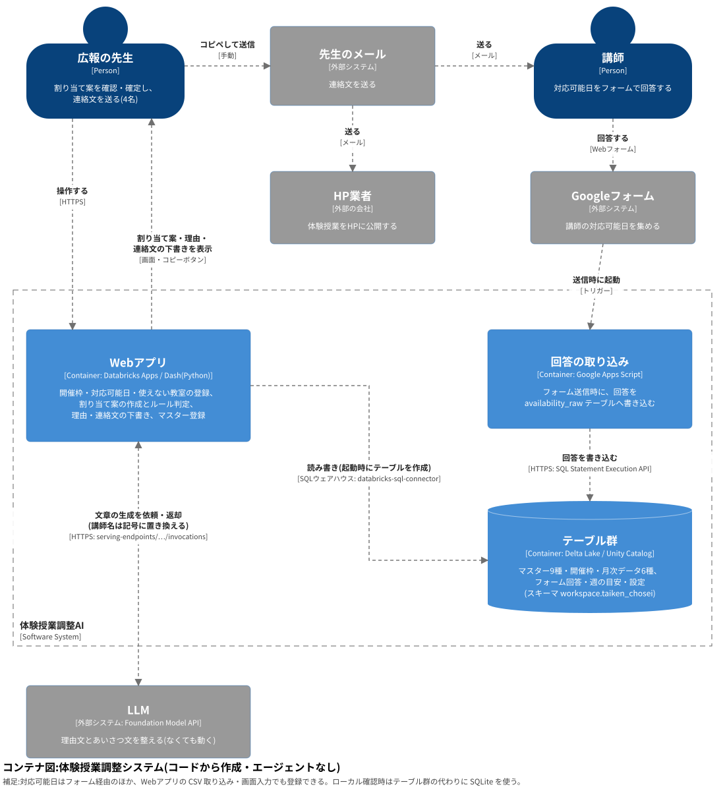
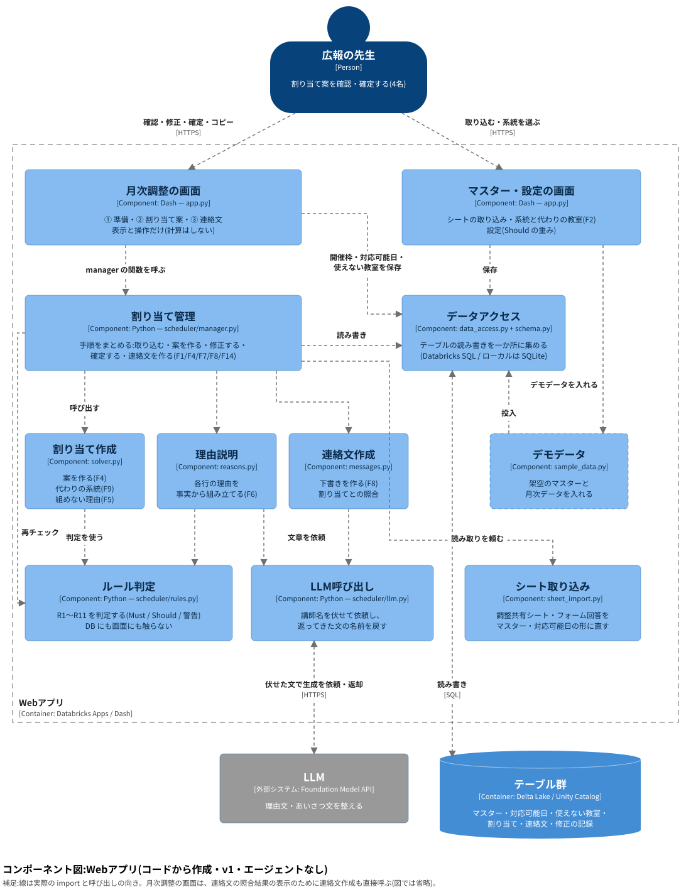

# 体験授業調整AI

オープンキャンパスの体験授業について、講師・日程・教室の割り当て案と、その理由、連絡文の下書きを作る Databricks App です。
割り当ての決定と連絡の送信は、広報の先生が行います(システムは下書きまで)。

要件定義書(叩き台)の v1「エージェントなし」の範囲を実装しています。

## できること

| 画面 | 機能 | 要件定義書の番号 |
|---|---|---|
| ① 準備 | 開催日と時間枠、早見表のイベント名の登録 | — |
| | 講師の対応可能日の取り込み(フォーム回答 / 回答の Excel・CSV / 表に直接チェック) | F1 |
| | 使えない教室・日時の登録 | F3 |
| | 週ごとの系統の目安の入力 | R6 |
| ② 割り当て案 | 1か月分の割り当て案の作成 | F4 |
| | 近い系統で代わりにする割り当て | F9 |
| | 組めなかった理由の表示 | F5 |
| | 各行の理由の説明(任意で AI が文を整える) | F6 |
| | 先生の修正・再チェック・確定 | F7 |
| | 確定した割り当ての保存(翌月の月またぎ判定に使用) | F14 |
| | 過去の割り当て CSV の読み込みとルール検証 | 6章「ルールの検証方法」 |
| ③ 連絡文 | 講師ごとの対応日のお知らせ、入れられなかった講師へのお礼、HP業者への連絡の下書き | F8 |
| マスター | 調整共有シート(体験授業一覧・教室)の取り込み。系統・代わりの系統・代わりの教室(R11)の登録 | F2 |
| 設定 | Should どうしの重み、1枠あたりの授業数 | 6章「あわせて決めたいこと」 |

まだ作っていないもの:F10・F11(打ち出し方の提案)、F12・F13・F15(エージェント)。

## 画面のデザイン

[Dash Mantine Components](https://www.dash-mantine-components.com/) で、shadcn/ui のような静かな業務ツールの見た目にしています(`theme.py`)。

- 白地に濃いグレーの文字。色を使うのは落ち着いた青1色だけ
- 枠は細い罫線、角は少し丸く、影は付けない。余白は広め
- ルール違反は赤ではなくオレンジで知らせる(先生が「確認して直すだけ」と感じられるように)

## 調整共有シートとフォーム回答の読み方

先生は Databricks を直接触らず、ふだんのスプレッドシートとフォームに入力します。

| 元のデータ | 読むところ | 入るテーブル |
|---|---|---|
| 調整共有シート「体験授業一覧」 | 体験授業名・講師名(「/」区切り)・必要なソフト・優先して入れる教室・予備教室・定員目安・備考 | course, teacher, teacher_course, course_software, course_room |
| 調整共有シート「教室」 | 教室名・入っているソフト(「使用しない」の教室は使わない) | room, software, room_software |
| フォームの回答 | メールアドレス・講師名・開催日ごとの「午前午後/午前のみ/午後のみ/対応不可」 | availability(講師はメールアドレス→名前の順に照合) |

- 「303301501」のように続けて書かれた教室は、教室シートの教室名で区切ります。
- 同じ体験授業名の行は1つの授業にまとめ、講師を複数持たせます。
- 教室シートに載っていないソフト・機材(3Dプリンターなど)は、教室の判定(R2)に使えないため、取り込み時に知らせます。
- 系統は体験授業一覧に列がないので、「マスター」画面で選びます。取り込み直しても残ります。
- 調整共有シートの「打ち合わせ調整」シートは読みません。

## 設計の要点

- **割り当てとルール判定はプログラム、文章だけ AI。** Must(R1〜R4・R9)を満たす候補しか案に入れません。
  Should(R5・R6・R8・R10)は重みを付けた点数にして、点数が最も上がる候補から入れます。同じ入力なら毎回同じ案になります。
- **連絡文の日付・授業・教室は、確定した割り当てからプログラムが差し込みます。** AI に頼むのはあいさつ文だけなので、
  割り当てと連絡文は食い違いません。画面でも照合結果(食い違い 0件)を表示します。
- **講師の名前は AI に渡しません。** 送る前に「講師A」などの記号に置き換え、返ってきた文で名前に戻します。
- **AI が使えなくても動きます。** エンドポイントが未設定・呼び出し失敗のときは、定型文に切り替わります。
- **ロジックは画面と DB に依存しません。** `scheduler/rules.py` と `scheduler/solver.py` は他の環境へそのまま移せます。

## アーキテクチャ図

コードの実際の構成(import と呼び出し関係)から作った図です。作り直すときは `python docs/architecture/make_diagrams.py` を実行します。

### コンテナ図



### コンポーネント図(Webアプリ)



## 構成(コンポーネント図との対応)

```
app.py                     割り当て画面・マスター画面(Dash Mantine Components。表示と操作だけ)
theme.py                   画面の色・書体・表の見た目
app.yaml                   Databricks Apps の設定
scheduler/
  manager.py               割り当て管理(案を作る・確定する・連絡文を作る)
  rules.py                 ルール判定(R1〜R11。DB には触らない)
  sheet_import.py          調整共有シート・フォーム回答の読み取り
  solver.py                割り当て案の作成、代わりの案、組めない理由
  reasons.py               理由説明
  messages.py              連絡文作成
  llm.py                   LLM 呼び出し(講師名を伏せる)
  data_access.py           データアクセス(Delta テーブル / ローカルは SQLite)
  schema.py                テーブル定義(ER 図に対応)
  sample_data.py           デモ用の架空データ
gas/form_to_databricks.gs  フォーム回答の取り込み(Google Apps Script)
gas/sheet_to_databricks.gs 調整共有シートの取り込み(Google Apps Script)
tests/                     テスト
```

テーブルはアプリの起動時に自動で作られます(`CREATE TABLE IF NOT EXISTS`)。前の版で作ったテーブルには、足りない列を起動時に追加します。定義は `scheduler/schema.py` を見てください。

## ローカルで試す

Databricks がなくても、SQLite で動きを確かめられます。

```bash
pip install dash==2.18.1 -r requirements.txt pytest
```

```bash
python -m pytest
```

```bash
python app.py
```

ブラウザで http://localhost:8000 を開き、「マスター」→「デモデータを入れる」を押すと、架空のデータで一通り試せます。
実際のデータで試すときは、「マスター」で調整共有シートの Excel を、「① 準備」でフォーム回答の Excel を選びます。

## Databricks にデプロイする

1. ワークスペースで **新規 → アプリ → カスタムアプリ** を作り、名前を付けます(例:`taiken-chosei`)。
2. アプリの **リソース** に次を追加します。キーは `app.yaml` と合わせます。

   | リソース | キー | 権限 |
   |---|---|---|
   | SQL ウェアハウス | `sql-warehouse` | Can use |
   | 文章生成 AI(任意) | `serving-endpoint` | Unity Catalog のモデルサービス(例:`system.ai.gemma-3-12b`)なら Execute、従来のエンドポイントなら Can query |

   エンドポイントを追加しない場合は、`app.yaml` の `SERVING_ENDPOINT` の2行を消してください(理由と連絡文は定型文になります)。
3. アプリのサービスプリンシパルに、テーブルを作る権限を付けます。SQL エディタで実行します。

   ```sql
   CREATE SCHEMA IF NOT EXISTS workspace.trial_class_scheduler;
   GRANT USE CATALOG ON CATALOG workspace TO `<アプリのサービスプリンシパルID>`;
   GRANT ALL PRIVILEGES ON SCHEMA workspace.trial_class_scheduler TO `<アプリのサービスプリンシパルID>`;
   ```

   カタログやスキーマの名前を変える場合は、`app.yaml` の `APP_CATALOG` / `APP_SCHEMA` も直します。
4. このリポジトリをアプリのソースとしてデプロイします。Databricks CLI の場合:

   ```bash
   databricks sync . /Workspace/Users/<自分のメールアドレス>/taiken-chosei
   ```

   ```bash
   databricks apps deploy taiken-chosei --source-code-path /Workspace/Users/<自分のメールアドレス>/taiken-chosei
   ```

   ワークスペースの Git フォルダーにこのリポジトリを取り込み、アプリの画面からそのフォルダーを指定してデプロイすることもできます。

## Google フォームの回答・調整共有シートを取り込む

- `gas/form_to_databricks.gs` をフォームの Apps Script に貼り付けます。回答は `availability_raw` に入り、「① 準備」の「フォームの回答を取り込む」で反映されます。
- `gas/sheet_to_databricks.gs` を調整共有シートの Apps Script に貼り付けます。「体験授業一覧」「教室」の行が `sheet_raw` に入り、「マスター」の「シートの内容を取り込む」で反映されます。

スクリプト プロパティとトリガーの設定は、各ファイルの先頭に書いてあります。
Apps Script を使わない場合は、どちらも Excel(.xlsx)でダウンロードして、アプリから選べば取り込めます。

## 仮に決めていること(先生に確認が必要)

要件定義書で【要確認】になっている点は、次の仮の決め方で実装しています。確認が取れたら直します。

| 項目 | 今の実装 | 直す場所 |
|---|---|---|
| R5 の「週」の区切り | 月曜始まりの週。開催のある週どうしで「続く2週」を数える | `models.week_key_of` / `rules.week_sequence` |
| 体験授業の系統 | 体験授業一覧に列がないため、マスター画面で選ぶ | 画面 |
| 代わりにできる系統 | マスター「代わりの系統」に登録した組み合わせ | 画面 |
| 優先・予備以外の教室 | 使ってよいが「講師に動作確認を」と警告する(ルール一覧 No.1) | `rules.check_room_priority` |
| R6 の打ち出し方 | 週 × 系統のコマ数の目安を入力 | 画面 |
| R10 の「1教室ほど余裕」 | 3月は各枠で空き教室を1つ残す(Should) | 設定画面 |
| Should どうしの優先順位 | 重み R5=50、R8=40、R6=20、R10=15 | 設定画面 |
| 1枠あたりの授業数 | 目安2、上限3 | 設定画面 |
| ソフト情報が「古い」 | 確認日から180日を超えたら警告 | 設定画面 |
| HP業者への連絡の形 | 日付・時間帯・授業名・担当の箇条書き | `messages.hp_schedule` |

## 動作確認の状況

- ロジックとデータアクセスは、テスト(SQLite)で確認済みです。
- 画面は、ローカルでブラウザから一通り操作して確認済みです。
- Databricks 上では次を確認済みです。
  - GitHub の `main` からのデプロイと起動
  - 起動時にスキーマ `workspace.trial_class_scheduler` へテーブルが作られること
  - 文章生成 AI(`system.ai.gemma-3-12b`)が AI Gateway の呼び出し方で応答すること(アプリの外から1回呼んで確認)
- 今回の版(Mantine の画面・シート取り込み)は、テストで全画面の組み立てを確かめましたが、ブラウザでの操作はまだ確認していません。
- **Databricks 上の画面操作は未確認です。** アプリの画面はブラウザでのログインが必要なため、
  開発環境からは開けません。デモデータでの一通りの操作と、AI での理由の整え方は、実際に画面を開いて確認してください。

## 実際の割り当てとの一致を測る

`tools/evaluate_plan.py` は、実データ(調整共有シート・フォーム回答)で案を作り、体験授業早見表の実際の割り当てと比べます。
データベースは使わずメモリの中だけで動き、個人名は表示しません。過去の実績には対象月より前のシートだけを使います。

```bash
python tools/evaluate_plan.py 早見表.xlsx 調整共有シート.xlsx フォーム回答.xlsx 2026-11
python tools/evaluate_plan.py 早見表.xlsx 調整共有シート.xlsx フォーム回答.xlsx 2026-10 --given-teachers
```

`--given-teachers` は「どの講師がどの日に入るか」を実際と同じにして、授業と教室の選び方だけを見ます。

2026年11月の実データでの結果(再現率 = 実際の割り当てのうち、案と一致した割合):

| 見るところ | 直す前 | 今 | 講師×日を実際と同じにしたとき |
|---|---|---|---|
| 講師×日×時間帯 | 11% | 37% | (82%) |
| + 授業 | 6% | 32% | 65% |
| + 教室 | 6% | 19% | 47% |

どの講師をどの日に入れるかは、フォームで対応可能と答えた講師(1日あたり15〜17人)から実際は6〜8人を選んでいて、
その選び方の決め手がデータにないため、まだ当てられていません。
